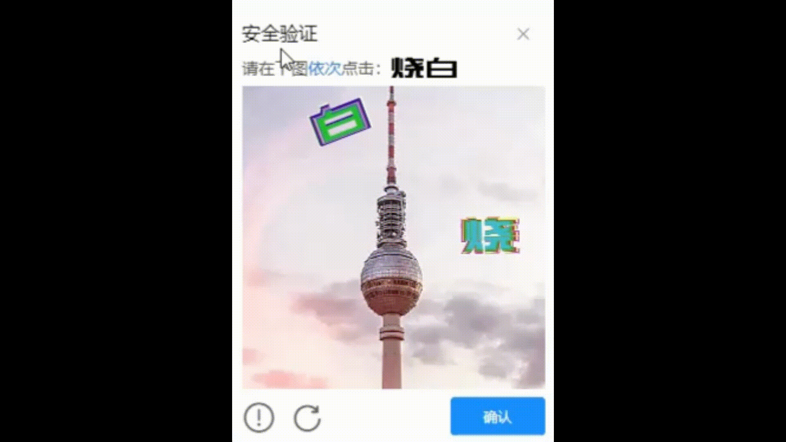
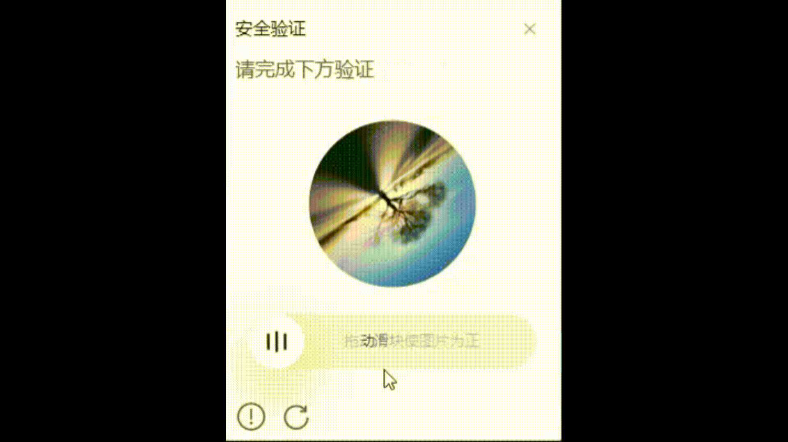
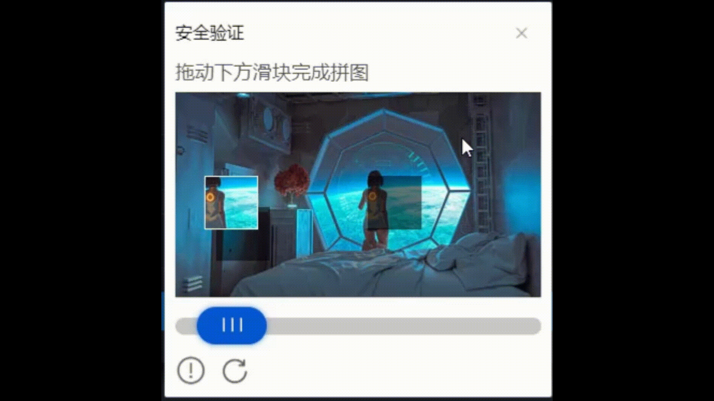
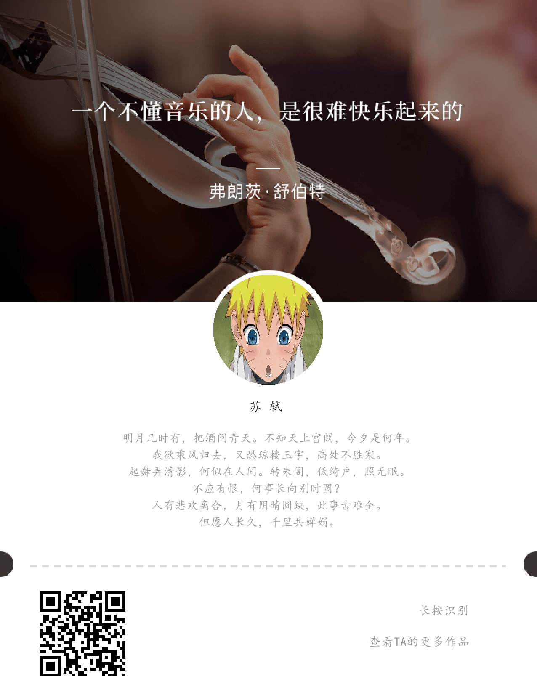
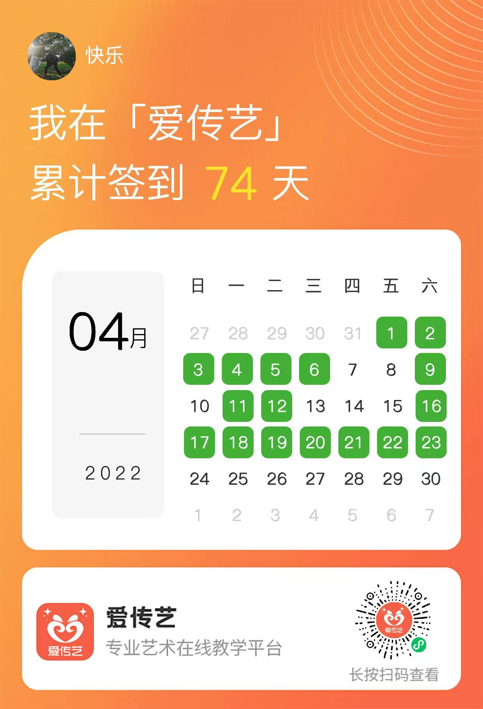
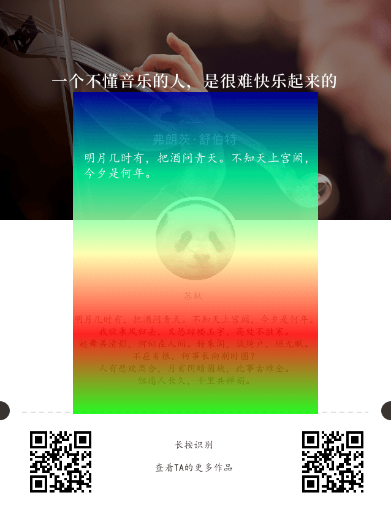

### **poster**

#### 介绍

**得益于 gd、imagick、phpqrcode、wkhtmltopdf**

**主要为了封装一个生成图片便捷的插件，非常感谢使用到的所有工具背后开发者的贡献**

PHP海报生成插件，极速生成方便快捷。

快速生成海报、生成签到日、生成二维码、合成二维码、图片添加水印

滑块验证图片生成、旋转验证图片生成、点击验证图片生成、输入验证图片生成

**小提示：**

**如果无法更新版本，composer 切换回原镜像**

全局设置

composer config -g repo.packagist composer https://repo.packagist.org

#### authors
lang
732853989@qq.com

群号 590660254 [点击链接加入群聊【海报图片验证交流群】](https://jq.qq.com/?_wv=1027&k=k374FhrR)

#### 使用文档

> 文档地址：http://www.520yummy.com/poster-doc/

#### 安装或更新

1.  composer require kkokk/poster
2.  composer update kkokk/poster

#### 演示效果

##### 字符串宽高测量

GD 和 Imagick 的文字对象均支持 `measure()`，无需先绘制图片：

```php
$text = (new \Kkokk\Poster\Image\Gd\Text())
    ->setText('海报文字示例')
    ->setFontSize(32)
    ->setMaxWidth(200)
    ->setLineHeight(40);

$size = $text->measure();
// $size['width']、$size['height']：向外取整后的排版框尺寸（像素）
// $size['lineCount']：排版行数
// $size['bounds']：相对第一行基线的 left、top、right、bottom，可为负数
// $size['advanceWidth']：未旋转的最大行前进宽度，包含空格占位
// $size['lines']：每行 width、lineHeight、baseline
```

将 `Gd\Text` 换为 `Imagick\Text` 即可使用 Imagick。字体路径、字号、字间距、行高、角度和限宽应与绘制时一致；GD 的内部字号 `3/4` 转换由库处理，调用方无需自行换算。`ImageText` 图文混排对象也支持同一方法。

`measure($maxWidth = null, $canvas = null)` 默认继承 `setMaxWidth()`；未设置限宽时，使用传入画布的宽度，无画布则不自动换行。显式传入 `0` 表示不自动换行，正数覆盖本次测量限宽，不修改对象配置。为匹配后续绘制，可使用 `$text->measure(null, $canvas)`，测量不会修改画布。

返回的是共享排版计算的外包框，包含旋转、加粗与多行定位，不是扫描抗锯齿像素所得的精确墨迹范围；空格前进距离与可见笔画宽度也不同。`bounds` 的原点是首行基线，若要把边界左上角放在 `(20, 20)`，可用 `$text->draw($canvas, 20 - $size['bounds']['left'], 20 - $size['bounds']['top'])`。空字符串返回零尺寸和零行数。字体与渲染环境可能产生少量像素差异，复杂文字 shaping、组合字素及整行 kerning 暂不支持。

##### **输入验证码验证**

数字、算术、中文、字母加数字

##### **点击图片验证**



##### 旋转图片验证



##### 滑块验证图片



##### 海报生成图片示例







演示地址：暂无

​	生成签到日历海报、邀请海报

> 注意：没有特别说明，统一都是px。

### 独立任务与配置重置

默认 Facade 和海报扩展会复用实例，驱动配置可能延续到下一次生成。队列等长驻进程中，每个独立任务可新建管理器：

```php
use Kkokk\Poster\Facades\Poster;

$poster = Poster::fresh();
$canvas = $poster->buildIm(300, 200)->getCanvas();

// 已有管理器中创建独立的指定驱动扩展，不继承之前的驱动配置。
$extension = $poster->fresh('imagick');
$canvas = $extension->buildIm(300, 200)->getCanvas();

$poster->reset('imagick'); // 移除该管理器的指定扩展；不传参数则移除全部扩展
Poster::reset(); // 移除 Facade 的海报管理器，下次调用重新创建
```

`fresh()` 不替换已有缓存实例；`reset()` 不改变已经创建的 Builder、画布或其他 Facade，也不删除缓存后端数据。需要任务隔离时，每个任务都应创建独立实例；传入同一可变图片对象的共享行为仍需由调用方注意。以上为新增 API，旧版本不包含。
### HTML 转换的超时与临时目录

```php
use Kkokk\Poster\Facades\Html;

$result = Html::fresh()
    ->load('<html><body>Hello Poster</body></html>')
    ->tempDirectory(sys_get_temp_dir()) // 必须是已存在的可写目录
    ->timeout(30) // 正数秒数，默认60秒
    ->output(__DIR__ . '/result.png', 'png')
    ->render();
```

运行 PHP 的进程必须能从 PATH 找到 wkhtmltoimage/wkhtmltopdf，并允许 proc_open、proc_get_status、proc_terminate。图片可以省略 output，此时通过返回对象的 getImageBlob() 读取；临时输出在该对象销毁时清理，PDF仍需明确输出路径。输出目录必须存在且可写。

转换失败、超时或未产生非空输出会抛 PosterException。本轮结果通过检查后才替换目标文件；失败保留旧目标。临时HTML在本轮结束时清理。timeout 负责直接子进程，不保证终止任意后代进程树。command() 是可信原生参数入口，不可透传用户输入。Windows部分特殊文件名的传参仍有限制。

尺寸、裁剪和质量要求非负整数；质量高于100钳制100。上述新增配置不适用于旧发布版本。
### 远程图片下载策略

GD与Imagick远程位图共用一次下载，默认读取期限15秒、20 MiB、4000万像素。大素材可能需要显式调整限制；远程SVG等不能通过位图预检的格式不在本入口支持范围。

```php
use Kkokk\Poster\Image\Resources\RemoteImageLoader;
use Kkokk\Poster\Image\Gd\Image;

$loader = new RemoteImageLoader(10, 10 * 1024 * 1024, 20000000, ['images.example.com']);
$image = new Image('https://images.example.com/product.png', $loader);
// Imagick\Image 同样支持第二个可选参数。
```

白名单按精确主机名匹配，启用后禁用自动重定向；默认不设白名单并允许最多5次跳转。白名单不提供DNS/IP级别的SSRF防护。总读取期限从打开流后开始，连接阶段另受流超时约束；不是整个网络任务的硬期限。限制仅覆盖输入字节和预检像素，不保证解码内存或多帧总像素上限。下载失败、超限及无效素材抛 PosterException。

策略按图片实例注入，不改变其他对象。本节为新增能力，旧发布版本不包含。
### 可选缓存命名空间

```php
use Kkokk\Poster\Cache\NamespacedCacheAdapter;
use Kkokk\Poster\Cache\RedisCacheAdapter;
use Kkokk\Poster\Facades\Cache;

// $redis 是调用方已连接的 Redis 客户端。
Cache::setAdapter(new NamespacedCacheAdapter(new RedisCacheAdapter($redis), 'poster-captcha'));
```

命名空间装饰器隔离 get/put/pull/has/forget 的键，并将 pull 直接委托底层，原子性取决于底层实现。flush() 会抛 PosterException，不会清空整个 Redis、Memcached 或 Session；请用 forget() 删除已知键。现有未包装的适配器行为不变。

此功能显式开启，启用后物理键改变，旧缓存不会自动迁移或删除。命名空间是应用约定，不是安全权限边界。以上为新增 API。
### 独立图片副本

GD与Imagick图像对象可调用 `$copy = $image->copy();`，副本复制底层图像，适合对同一素材分别处理。修改或销毁副本不应影响原图。原有传入图片对象的共享行为不变，不要用普通赋值替代复制。

此方法面向图像像素资源，不承诺递归复制富文本内容、加载策略或其他嵌套对象；Imagick由驱动原生克隆，GD副本转为真彩色并保留像素透明度，不保证编码字节/调色板结构一致。新增API不适用于旧版本。
### 开发回归验证

```bash
php tests/regression/run.php --list
php tests/regression/run.php core
php tests/regression/run.php image
php tests/regression/run.php http
php tests/regression/run.php html
php tests/regression/run.php redis
```

默认运行core组；image组需要可用的GD、Imagick、字体和图像编码模块；http组启动临时回环HTTP服务；html组需要PATH中的wkhtml程序；redis组使用POSTER_REDIS_HOST/POSTER_REDIS_PORT（默认127.0.0.1:6379），仅操作随机测试键。测试不会自行安装依赖或启动Redis。任何脚本失败使整组返回非零退出码，缺失依赖不视作通过。

各脚本运行于独立PHP进程。text_measure已包含text_layout回归，统一入口避免重复执行。Predis替身脚本不纳入常规组，不能替代真实客户端验收。tests不随发布归档分发，以上命令用于仓库检出环境。
GitHub Actions 配置位于 `.github/workflows/regression.yml`，针对 PHP8.2 运行语法及core/image/http分组。工作流提交并推送后才会触发，当前仅本地配置完成，尚无远端CI通过记录。Linux字体/驱动版本可能产生渲染差异，需以首次CI实际结果调整。PHP5.6声明未改变，也未因此证明旧版本兼容；Gitee CI未配置。
### 最大行数与省略符

```php
$text->setMaxWidth(240)->setMaxLines(2, '…');
$size = $text->measure();
```

Text、ImageText均支持。0表示不限行，恢复默认行为；行数必须是非负整数。仅在内容确实超出行数时添加省略符，自定义省略符不能包含换行，可传空字符串以直接截断。ImageText应在外层设置限制，子Text的行数设置不控制整段混排。

省略符继承最后可见文字的样式，并参与宽度计算；极窄区域会先移除正文，再缩短省略符。没有可见文字样式时不添加省略符。测量与绘制共用截断结果，截断不会改写原文。宽度约束按未旋转前进宽度计算，不保证旋转后布局框同宽。此功能为新增API。
### 指定区域自动字号

```php
$fit = $text->fitFontSize(240, 100, 8, 48, $canvas);
if ($fit['fits']) {
    $text->setFontSize($fit['fontSize'])->setMaxWidth(240)->setMaxLines(0);
    $text->draw($canvas, 20, 100); // 数字坐标仍为基线
}
```

仅支持GD/Imagick的Text；ImageText暂不支持。返回fontSize、fits及metrics，不修改原对象或画布。完整文本参与适配，计算忽略最大行数截断；应用时也应关闭截断并使用相同限宽。宽高必须为有限正数，字号范围为正整数且跨度不超过1000，返回能放入区域的最大整数字号。

无可行字号时返回最小字号、fits=false，不会自动截断。空文本返回最大字号。探测与应用setFontSize都会按现有规则重算行高，独立自定义行高不参与本方法。尺寸以布局边界为准，旋转时同时检查旋转后的宽高；绘制位置仍需按基线或measure返回的bounds定位。逐级测量保证不依赖字号尺寸的单调性，大范围/长文本可能耗时。新增API，GD字号3/4换算由库内部保留。
### 矩形区域内对齐

```php
$text->drawInBox($canvas, 20, 30, 240, 100, 'center', 'center');
```

Text/ImageText均可调用，依次指定画布、区域x/y/宽/高、水平left/center/right和垂直top/center/bottom。默认left/top；数字区域坐标是左上角。按照布局边界定位（包含旋转），区域宽度控制本次换行，区域高度只用于对齐，不裁剪、不自动缩小；超高内容可能超出区域。多行内部对齐仍由setFontAlign控制。

本次绘制结束恢复对象原来的限宽和画布上下文。使用fitFontSize后可先应用字号，再调用drawInBox定位；完整文本适配时关闭setMaxLines截断。新增API。
### 可选英文单词换行

```php
$text->setMaxWidth(240)->setWrapMode('word');
$text->setWrapMode('character'); // 恢复默认按字符换行
```

Text和ImageText均支持；ImageText在外层设置策略。word保护连续ASCII字母、数字及下划线组成的词，可跨Text样式片段；放不进一整行的长词回退字符换行。中文仍按字符处理，显式换行和空格原样保留，不自动修剪行尾空格，不实现中文标点避头尾、连字符规则或Unicode语言分词。

策略同时作用于measure、draw、自动字号和区域对齐，可与最大行数配合。省略符仍按字符适配，可能移除末行部分单词以腾出空间。新增API，默认输出行为不变。
### 查询逐元素排版结果

`Text`、`ImageText` 新增 `layout($maxWidth = null, $canvas = null)`，参数与 `measure()` 一致。返回测量汇总及 `elements`：`type`、从0开始的 `line`、`x/y`、`advanceWidth` 和旋转后轴对齐 `bounds`；文字另含 `text/angle`，图片另含 `width/height`。

```php
$result = $text->layout(240, $canvas);
$elements = $result['elements'];
```

坐标相对第一行基线，文字锚点是基线、图片锚点是左下角；未包含画布居中或区域定位。换行没有元素，空行保留在 `lines`，省略符作为文字返回。边界为字体度量范围，非精确墨迹。结果只含纯数据，不暴露图片资源或内部样式，不能直接作为绘制输入。不改变原对象；旧版v3.0.5不包含此API。

### 可选字素安全模式

```php
$text->setTextUnit('grapheme'); // Text或外层ImageText
$result = $text->layout(240, $canvas);
$text->setTextUnit('codepoint'); // 恢复默认码点模式
```

grapheme模式使用当前PCRE的Unicode `\X`，同一Text片段内的组合重音、ZWJ等序列作为一个元素参与测量、绘制、换行和省略符移除。超宽字素可单独占一行，不从内部拆分；省略符放不下时整簇移除。layout新增textUnit说明text字段的单位；measure字段不变。ImageText由外层模式决定，跨Text片段不合并，即使样式相同也须将完整序列放在同一片段。

默认不变，不需要intl。非法模式抛PosterException；字素拆分遇无效UTF-8或PCRE失败会抛异常。支持的Unicode序列取决于PCRE版本，PHP5.6未验证。word策略仍只识别单个ASCII字母数字下划线，带组合标记的字素不属于此词规则。此模式不提供复杂shaping、双向文本、整行kerning、字体fallback或彩色emoji正确性保证。旧版v3.0.5不包含该API。

### 图片适配与裁剪位置

```php
$image->fit(300, 200, 'contain'); // 等比适配，不补边，返回实际尺寸
$image->fit(300, 200, 'cover', 1, 0); // 等比覆盖后裁剪，靠右、靠上
$image->fit(300, 200, 'fill'); // 拉伸至精确尺寸
$separate = $image->copy()->fit(100, 100, 'cover');
```

GD/Imagick的Image和Canvas支持 `fit($width, $height, $mode = 'contain', $focusX = 0.5, $focusY = 0.5)`，原地修改并返回当前对象。宽高必须为正整数，允许放大；contain不添加背景，极端比例最少保留1像素。cover向上取整缩放尺寸，再裁剪到目标尺寸；focus为多余宽高裁剪距离的0..1比例，0靠左/上、1靠右/下，默认居中，不是主体识别坐标。fill可能改变宽高比。非法参数抛PosterException。

PNG透明度保留，JPEG不支持透明。两驱动重采样算法不同，不承诺像素完全一致。本轮验证范围为单帧图片，动画、ICC/EXIF和超大图内存未专项验证。原thumb/scale/crop行为不变；旧v3.0.5不包含fit。

### 布局调试预览

```php
$preview = $text->debugLayout($canvas, 40, 80);
$preview->getData('/absolute/path/debug.png');
```

Text、ImageText的debugLayout返回独立画布副本，在副本上绘制内容及辅助线，输入画布和文字配置不变。x/y仅接受有限数值，仍表示第一行基线；请传入尚未绘制该段内容的画布，避免重复叠字。默认draw不会添加调试线。

红：整体布局边界；绿：各行元素边界（空行保留行高）；橙：元素边界；蓝：水平行基线参考；紫：元素锚点十字。线框重叠时后绘制颜色覆盖前者。旋转片段的实际锚点由十字标示，蓝线不是旋转后的字形基线。边界仍为字体度量轴对齐框，非精确墨迹。画布外辅助线会被裁切；不支持符号居中或drawInBox定位。需使用内置同驱动且支持copy的画布。旧版v3.0.5不包含此方法。

### 环境诊断

```php
$diagnostic = new \Kkokk\Poster\Diagnostics\Environment();
$report = $diagnostic->check([
    'fonts' => ['/absolute/path/font.ttf'],
    'temporaryDirectory' => sys_get_temp_dir(),
    'binaries' => ['wkhtmltopdf' => '/absolute/path/wkhtmltopdf'],
]);
```

无需参数时检查随包simkai.ttf、系统临时目录与当前PHP能力。check返回ready、phpVersion、sapi和按名称索引的checks；每项含status(ok/warning/error)、required、value及失败时advice。ready只表示必需静态检查通过；Imagick、Redis、Predis和HTML进程/程序缺失属于可选警告，使用对应功能时仍需处理。只检查显式传入的程序文件，不搜索PATH，不执行程序或连接缓存，不实际写临时文件。

字体可读不等于字体有效/字形覆盖；目录可写不等于配额或实际写入已验证；程序存在不等于版本/依赖/实际转换可用。不同CLI/FPM进程需分别检查。报告含本机路径，仅用于管理端诊断，避免直接公开。旧v3.0.5不包含此API，PHP5.6尚未运行验证。

### 图像性能基准（源码开发工具）

```sh
php tests/benchmark/image.php 256 3
```

尺寸范围8..1024，重复次数1..10；默认256和3。每次用独立PHP进程及固定RGBA/灰度素材执行GD/Imagick圆形、遮罩、带条件抠图，输出JSON：中位/最小/最大耗时、PHP峰值内存、逐像素SHA256及透明度统计。重复结果摘要不同会失败，不设置跨机器时间阈值；两驱动不要求摘要一致。

计时只覆盖操作，不含加载、PNG编码及摘要；PHP峰值含素材构造和加载，不含后续编码/摘要，不能视作进程RSS或原生库总内存。摘要记录现状，并不证明输出正确；优化前需验证像素、透明度及回调语义。需GD和Imagick及可用模块配置，缺失时失败。脚本在tests中，发布归档不包含，请在源码检出中运行。

### 遮罩、抠图与PNG透明度修复

灰度遮罩现在按“源不透明度 × 遮罩亮度”合成：黑色使结果透明，白色保留原透明度；不会把源透明像素重新变为不透明。使用不透明灰度遮罩；彩色遮罩在两驱动的历史通道处理不同，不承诺一致。

cutout未选区域统一透明，选中像素保留原alpha和RGB；回调仍按原先x外层/y内层遍历整个源图。Imagick原先白底抠图的输出会有意变化。圆角保留原alpha，Imagick alpha换算去除百分比截断。

带alpha的Imagick PNG通过库的编码出口使用显式RGBA，避免本机GD解码全透明灰度PNG时丢失透明度；PNG字节及大小可能变化，不改变JPEG/GIF格式。直接调用原生getImage()->getImageBlob()绕过库编码处理。已验证单帧PNG，动画和其他ImageMagick构建仍需验证。

### Imagick抠图原生路径

无回调且x1/y1为PHP整数时，cutout使用原生合成，减少逐像素绘图开销。有回调或非整数坐标仍使用原逐点路径，保留回调的全源遍历顺序和修改源图后的即时取色行为。返回画布、裁剪偏移、越界透明区域及alpha语义不变；具体速度取决于图像和环境，不保证所有调用都提速。基准中的cutout为条件回调，cutout_all为无回调，须分别比较。
